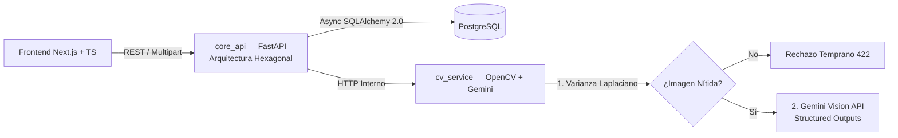

# DocScan Monorepo — Extracción Inteligente de Documentos

Monorepo políglota para el escaneo, validación de calidad óptica y extracción estructurada de facturas y recibos mediante visión por computador e IA generativa. Construido bajo **Arquitectura Hexagonal (Puertos y Adaptadores)** con persistencia asíncrona y contenedores endurecidos.

- **Caso de estudio técnico:** [santiagoavirama.dev/proyectos/doc-scan](https://santiagoavirama.dev/proyectos/doc-scan)

---

## Arquitectura del Monorepo



### Componentes Desacoplados

- **`core_api` (Python / FastAPI):** Implementado bajo **Arquitectura Hexagonal**, aislando la lógica de dominio y casos de uso de los adaptadores externos (`SQLAlchemy 2.0 Async` + `asyncpg` sobre PostgreSQL).
- **`cv_service` (Python / OpenCV / Gemini API):** Microservicio autónomo que evalúa la nitidez de la captura mediante **varianza del Laplaciano** antes de invocar la inferencia estructurada con Google Gemini Vision API, evitando consumo innecesario de tokens en imágenes ilegibles.
- **`frontend` (Next.js / TypeScript):** Interfaz web tipada para carga, previsualización y auditoría de campos extraídos.

---

## Seguridad, Calidad y DevSecOps

- **Contenedores Endurecidos (_Least Privilege_):** Imágenes Docker multi-etapa ejecutadas con usuarios sin privilegios (`non-root`) y superficies mínimas de ataque.
- **Calidad Automatizada:** Pruebas unitarias y de integración con `Pytest`, análisis estático y formateo estricto con `Ruff`, validación en `pre-commit` y CI continuo en `GitHub Actions`.

---

## Variables de Entorno

| Variable              | Servicio     | Descripción                              |
| :-------------------- | :----------- | :--------------------------------------- |
| `DATABASE_URL`        | `core_api`   | URI asíncrona `postgresql+asyncpg://...` |
| `CV_SERVICE_URL`      | `core_api`   | URL interna del microservicio de visión  |
| `GEMINI_API_KEY`      | `cv_service` | Credencial de Google Gemini API          |
| `BLUR_THRESHOLD`      | `cv_service` | Umbral mínimo de varianza del Laplaciano |
| `NEXT_PUBLIC_API_URL` | `frontend`   | Endpoint público de `core_api`           |

---

## Levantar el Ecosistema Completo

```bash
git clone [https://github.com/DevAvirama/doc-scan-monorepo.git](https://github.com/DevAvirama/doc-scan-monorepo.git)
cd doc-scan-monorepo
cp .env.example .env
docker compose up --build -d
```

### Ejecutar Tests y Linters

```bash
# Backend / CV Service
pytest
ruff check .
```
